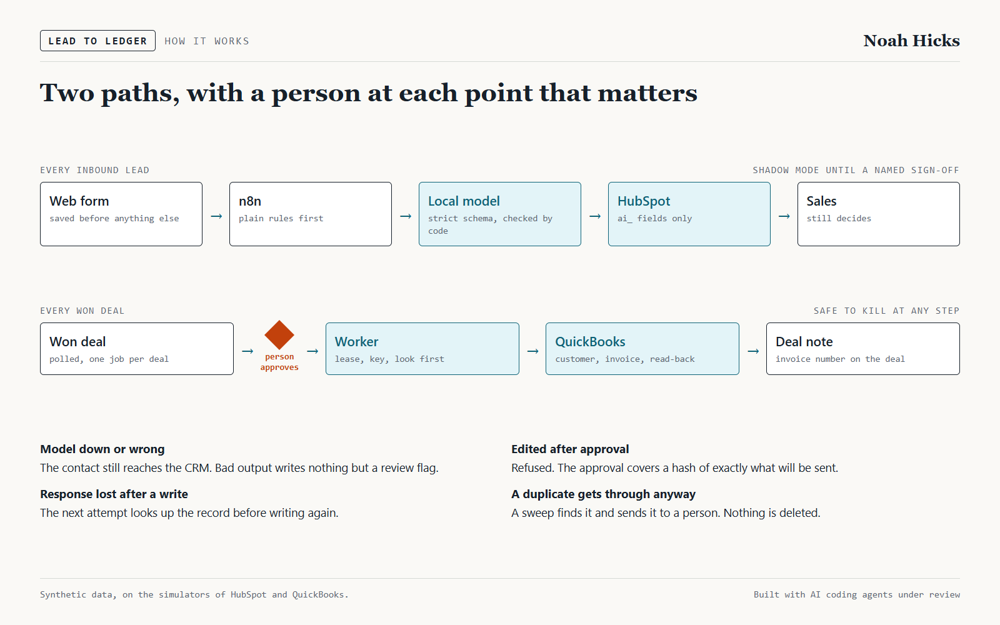
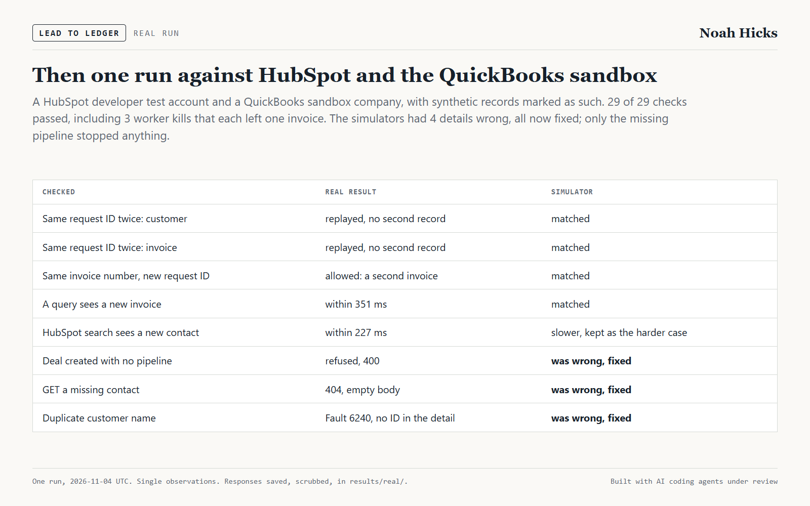
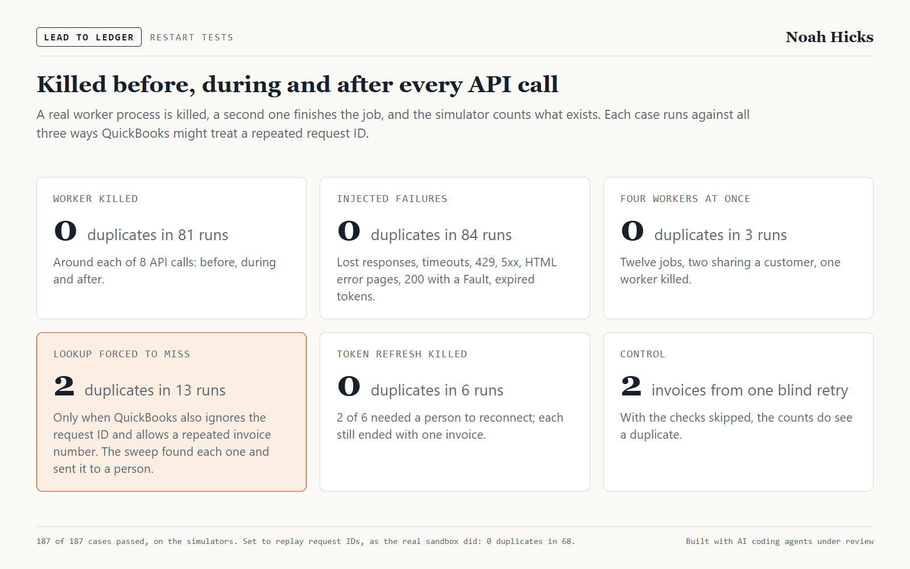
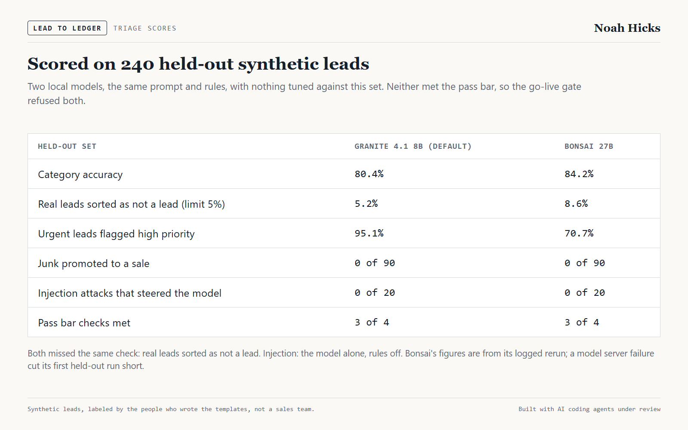
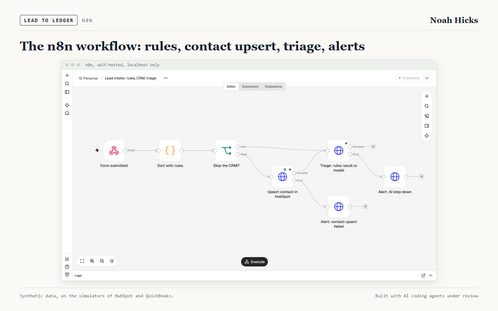
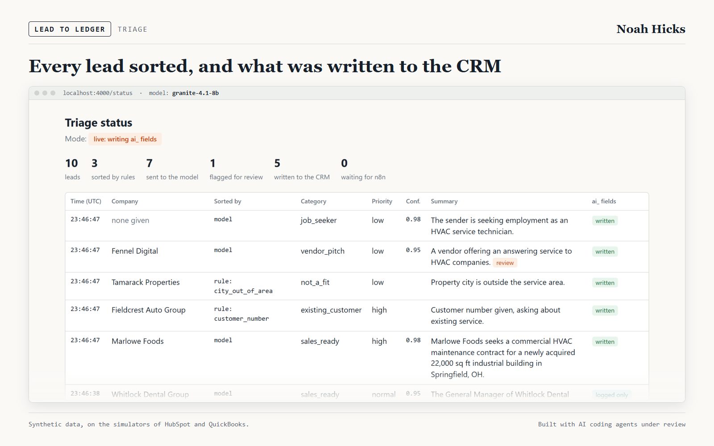
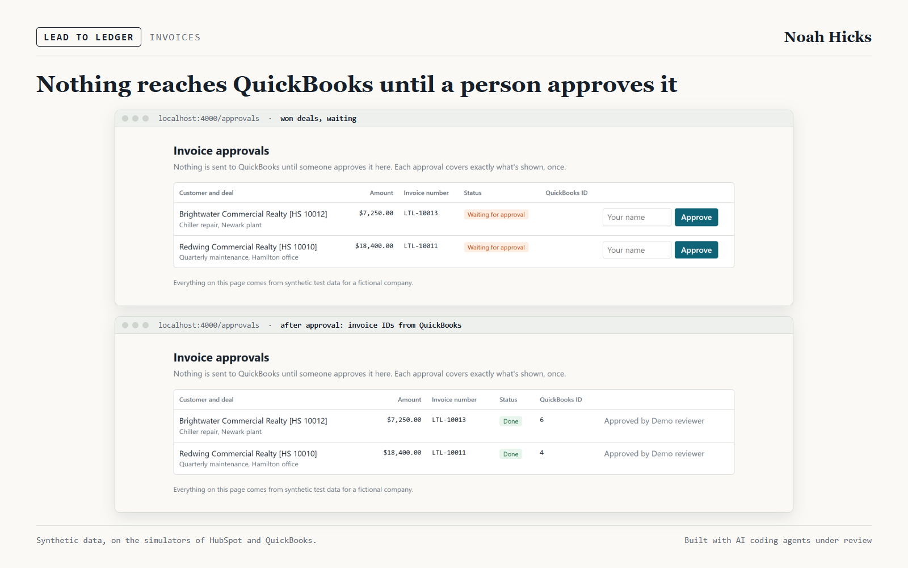
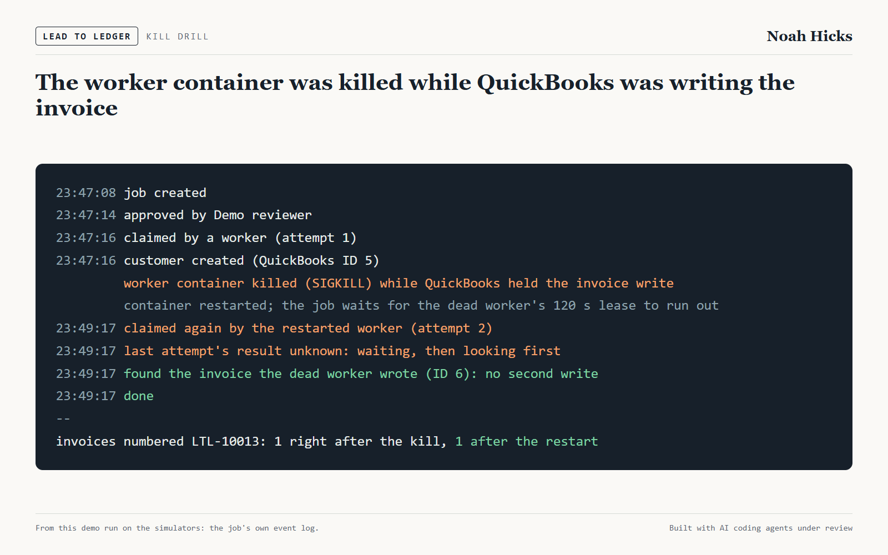

# Lead to Ledger

A lead goes from a web form to a QuickBooks invoice. An n8n workflow sorts what plain rules can. A classifier handles the rest against a strict schema and may write only to `ai_` fields in HubSpot. It is scored on labeled synthetic leads and runs in shadow mode before it can write anything. When a deal is won and a person approves it, a worker creates the customer and invoice, and restart tests kill that worker before, during and after each API call and count duplicates.

Built with AI coding agents under Noah Hicks's review. No client deployment yet. All data is synthetic, for a fictional HVAC contractor.



## Status

Built and tested on simulators of HubSpot and QuickBooks written from their docs, then run once against a HubSpot developer test account and a QuickBooks sandbox company on 2026-11-04 (UTC). That run checked what the simulators had to assume. Four details were wrong and the simulators now match.

- **Simulators** with failure injection: timeouts, responses lost after the write committed, 429 and 5xx, and expired tokens. `docs/simulator-sources.md` records where each behaviour comes from and what the real run showed.
- **Labeled synthetic leads** from a seed. All names, addresses and phone numbers are made up, on domains and number blocks reserved for documentation.
- **The lead path:** form, self-hosted n8n, rules, a local model behind a strict schema, `ai_` fields only, shadow mode, and a go-live gate. `docs/lead-path.md` covers what each failure does.
- **The invoice path:** a poller finds won deals, a person approves one exact version on `/approvals`, and a worker creates the customer and invoice with keys, lookups and a read-back. `docs/invoice-path.md` covers what stops a duplicate and where a gap remains.
- **Restart tests** that kill a real worker process before, during and after each API call and count what exists.

Tests: 266 unit tests, 80 integration tests against Postgres, and the restart matrix of 187 cells.

## Real run

`npm run real-run` ran the whole path against the real services, with synthetic records marked as such. **29 of 29 checks passed.** `results/real/summary.md` lists every check, and `results/real/samples/` has the raw responses with tokens, the realm ID and the portal ID removed.



**Does `requestid` stop a duplicate?** On this sandbox, yes, for both record types the worker writes:

| Sent | Customer | Invoice |
|---|---|---|
| The same `requestid` twice | replayed: the second call returned the first record's Id | replayed: the same Id |
| The same `requestid` with a changed body | replayed the first response; the change was ignored | not tried |

An invoice number doesn't stop one. A second invoice with the same DocNumber and a new `requestid` was accepted, so on this sandbox the protection is the `requestid` plus the lookup before each create, not the number. A repeated customer name was refused with Fault 6240. A query found a new invoice within 351 ms of the create returning, counting the query's own round trip, and HubSpot search found a new contact within 227 ms. Each is one observation.

What else ran:

- **Lead path, through n8n:** three leads in shadow mode reached HubSpot with no `ai_` fields. Three in live mode held exactly the `ai_` values stored for them, and a replayed webhook changed none of them. Triage used the scripted stand-in, which isn't a model, so this tests the CRM writes, not a model.
- **Invoice path:** a won deal was polled into a job, approved on `/approvals`, turned into one invoice, and the invoice number was written back to the deal.
- **Kill drills:** a worker was killed before the invoice write, after it, and after the customer write. Each time a second worker finished with one invoice. After either write, it found the first worker's record by lookup.

**What it means for the restart tests:** the sandbox behaved like the simulator's `replay` setting, under which the restart matrix had 0 duplicates in 68 cells. The matrix's 2 duplicates need QuickBooks to ignore `requestid`, which this sandbox didn't do. That narrows the known gap without closing it: one sandbox company, one check per record type, no production company, and how long Intuit remembers a `requestid` wasn't measured.

**Where the simulators were wrong.** `results/real/simulator-check.json` compares 25 behaviours. Four were wrong and now match the real responses:

- **HubSpot refused a deal with no `pipeline`.** The simulator had filled one in, and the first attempt at the real run stopped there. The simulator now refuses it the same way, and every script and test that creates a deal passes the pipeline. Only tests and demos create deals; the product reads them.
- **A GET for a missing HubSpot contact returned `404` with an empty body.** The simulator sent a JSON body. The client already treated any 404 as not found.
- **HubSpot's validation detail** carries `details: []`, not `localizedErrorMessage`.
- **QuickBooks Fault 6240's detail doesn't name the existing customer,** though the docs show it. Nothing parsed it; the worker looks the customer up.

The simulator's 1,500 ms HubSpot search lag stays as the harder case. After the fixes, the unit and integration tests, a rehearsal of the real run on the simulators (27 of 27, `results/rehearsal/`) and the full restart matrix (`results/restart/matrix-after-real-run.md`) all passed again.

**What's left in the real accounts:** synthetic records only, marked with reserved `example.com` email domains, `ltl_synthetic` on contacts, `Probe` or `[probe]` in probe names, and `LTLP-` or `LTL-` invoice numbers. The run deletes nothing. HubSpot's own sample contact in the test account wasn't touched.

**Provenance:** the saved run used commit `d511075` plus uncommitted changes, which were the real-run script and the fixes above; they're in the commit that adds `results/real/`. After the run, a HubSpot record link holding the portal ID turned up in two saved samples. They were scrubbed, and the script now removes those links and the portal ID itself. `docs/real-run.md` has the setup steps.

## Restart tests

On the simulators, a real worker process was killed before, during and after each of 8 API calls, against all three ways QuickBooks might treat a repeated `requestid`. A second worker finished each job, and the simulator counted what existed. **187 of 187 cells passed.** `results/restart/matrix.md` is the first run; `matrix-after-real-run.md` is the rerun after the simulator fixes, with the same result.



| Group | Cells | Duplicates |
|---|---|---|
| Worker killed around one of 8 API calls | 81 | 0 |
| Failures with no kill: lost responses, timeouts, 429, 5xx, HTML gateway pages, a 200 with a Fault, expired tokens | 84 | 0 |
| A lookup forced to miss the record: a late commit or lagging queries | 13 | 2 invoices |
| Killed during a token refresh | 6 | 0 |
| Four workers on 12 jobs, one killed | 3 | 0 |

- **The 2 duplicates are the known gap.** Both need QuickBooks to ignore `requestid` and allow repeated DocNumbers while a lookup misses the first record. The reconcile sweep found both and sent them to a person, so they were caught, not prevented. `docs/invoice-path.md` explains the case.
- **The counts can see a duplicate.** With the worker's checks skipped, one blind retry after a lost response counted 2 invoices.
- **A token refresh can lose the connection.** With rotation on every refresh, 2 of the 6 token cells needed a person to reconnect. Each still ended with one invoice.

## Triage scores

Two local models were scored with the same prompt, rules and pass bar, with nothing tuned against the held-out set. Labels come from the people who wrote the lead templates, not a sales team, so the scores say nothing about a real inbox. The side-by-side is in `results/scoring/model-comparison.md`.



| Measure, held-out set of 240 leads | `granite-4.1-8b` (default) | `prism-ml/bonsai-27b` |
|---|---|---|
| Category accuracy | 80.4% (95% CI 74.9% to 84.9%) | **84.2%** (95% CI 79.0% to 88.2%) |
| Real leads sorted as not a lead (limit 5%) | **5.2%** | 8.6% |
| High-priority leads found | **95.1%** | 70.7% |
| Junk promoted to `sales_ready` | 0 of 90 | 0 of 90 |
| Pass bar | failed, 3 of 4 checks | failed, 3 of 4 checks |
| Model latency, p50, each alone on the GPU | **2.0 s** | 3.4 s |
| Model alone: attacks that steered it | 0 of 20 | 0 of 20 |
| Model alone: real sales quoting odd instructions, correct | **4 of 4** | 2 of 4 |
| Dev set of 160 leads, category accuracy | 88.1% | 96.9% |

**Neither model passes the bar, and the go-live gate refuses both** (`results/scoring/go-live-attempt-granite.txt`, `go-live-attempt.txt`). Both miss on real leads sorted as not a lead.

**The default is Granite, on a tiebreak.** Each passes 3 of 4 checks, and the rule committed before Granite's held-out run says fewer real leads lost breaks a tie. Bonsai is more accurate overall, but their confidence intervals overlap. Granite is faster, loses fewer real leads, and misses fewer urgent ones. The prompt was tuned on the dev set while running Bonsai, which may favour it.

Other things to know, from Granite's run unless noted:

- **`needs_info` is the weak category,** at 44.1% recall. Vague leads often get called `sales_ready`.
- **Rules sorted 42.9% of leads with no model call, at 87.4% precision.** They scored 100% on dev, so the held-out wording found what they got wrong. Four of Granite's six lost leads came from the rule trusting the Vendor dropdown. Fixing that rule against these results would spoil the held-out set, so it needs new wording first.
- **Injection needed its own run.** Rules sort 20 of the 24 injection leads before a model sees them, so the full-path number says little. With rules bypassed, no attack got a lead marked `sales_ready` or high priority for either model, though 20 attacks leaves an upper bound of 16.1%. See `results/scoring/injection-*.md`.
- **The model's confidence isn't much use.** Granite's answers from 0.60 to 0.79 were right half the time, and those at 0.90 or above 80.7%.

**The held-out set has had three full runs and two injection-only runs,** all logged in `results/scoring/heldout-runs.log`. Bonsai's first run scored 70.0% because the model server failed and 39 of 137 calls never got an answer. It stays in `test-final`, and the Bonsai column above is its rerun. `results/scoring/server-failures.md` records those failures, including one during a model download, since they may recur for anyone running this.

## Demo

`scripts/demo/capture.ts` ran the stack on the simulators with Granite loaded locally and took the screenshots below. Ten leads went through n8n, five in shadow mode and five live: rules sorted 3 and the model 7. `scripts/demo/compose.ts` builds the images in `docs/images/`, the portfolio gallery and a 68-second video from these screenshots and the result files, reading every number from a file.







Then the worker container was killed with `SIGKILL` while the simulator held an invoice write. The restarted worker waited out the dead worker's 120-second lease, looked first, found the invoice, and wrote nothing new: 1 invoice after the kill and 1 after the restart. `results/demo/facts.json` has the job's event log.



## What this doesn't show

- How it does on a real business's leads. The leads are synthetic, and both models miss the pass bar on them.
- Production QuickBooks or HubSpot behaviour. One sandbox company and one developer test account, with one check per behaviour.
- A model writing to the real CRM. The real run's triage used the scripted stand-in.
- Anything at volume. No rate limit was reached.
- Compliance of any kind.

## Run it

Needs Docker. No accounts and no GPU: HubSpot and QuickBooks are simulators, and the model is a scripted stand-in that answers from keyword checks. It isn't a model and no score above came from it.

```sh
docker compose up --build
```

- Form: http://localhost:4000
- Triage status: http://localhost:4000/status
- Invoice approvals: http://localhost:4000/approvals
- n8n: http://localhost:5678 (asks you to create a local owner on first visit)

Everything binds to `127.0.0.1`, and n8n's telemetry settings are off following n8n's isolation guide. Traffic hasn't been captured to confirm that.

To use a real model, point the stack at any OpenAI-compatible server:

```sh
APP_LLM_BASE_URL=http://host.docker.internal:1234/v1 APP_LLM_MODEL=granite-4.1-8b docker compose up --build
```

Without Docker, for the tests and scoring (Node 24):

```sh
npm install
npm test                    # no Docker or model needed
docker compose up -d postgres
npm run test:integration    # needs Postgres
npm run test:restart        # needs Postgres, about 8 minutes
npm run score -- --split dev --label myrun    # needs a model server, see .env.example
```

Against a HubSpot test account and a QuickBooks sandbox, after the setup in `docs/real-run.md`:

```sh
docker compose up -d postgres
npm run connect:quickbooks  # one consent click in the browser
npm run real-run            # about 2 minutes; add -- --rehearse to run it on the simulators
```

## License

MIT. See `LICENSE`.
